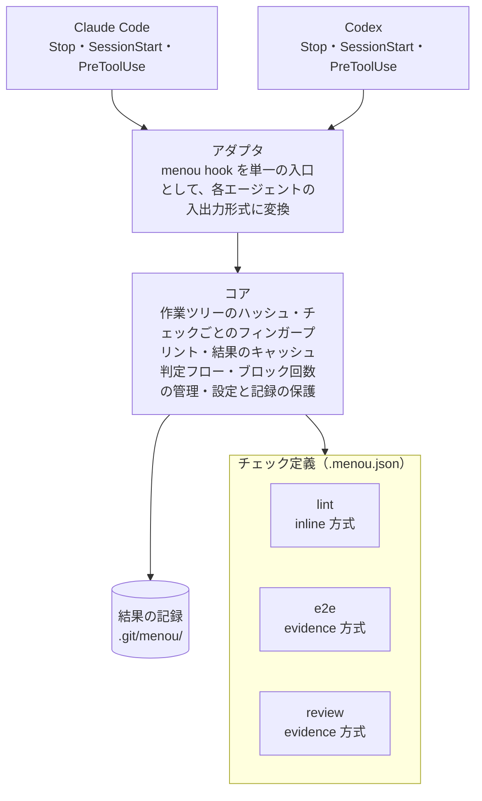

# アーキテクチャ

menou は 4 つの層で構成し、フックから呼ぶのは `menou hook <event>` という単一の入口だけにします。こうすると Claude Code と Codex で `hooks.json` を完全に共通化でき、差分はアダプタ層だけに閉じ込められます。



evidence 方式のチェックをエージェントが実行するときも `menou run <id>` でコアを通り、結果を記録するのは常にコアです。

## 各層の責務

| 層 | 責務 | 知らないこと |
| --- | --- | --- |
| アダプタ | フックの入力 JSON を読み、判定結果を各エージェントが受け付ける形式で出力する | チェックの中身、判定ロジック |
| コア | 状態のハッシュ計算、フィンガープリントとキャッシュ、判定、ブロック回数の管理、自己防衛 | 各チェックが何を検証しているか |
| プリセット | よく使うチェックの実行スクリプト（agent-review、e2e など） | 基盤の内部構造。普通のコマンドとして振る舞う |
| チェック定義 | プロジェクトごとの `.menou.json`。何をゲートするか | 実装の詳細 |

## チェックの 2 つの実行方式

| | inline | evidence |
| --- | --- | --- |
| 実行するのは | 完了時に基盤が実行 | エージェントが `menou run <id>` で実行 |
| 完了時の処理 | 実行して合否を判定 | 記録の合否と、記録がまだ有効か（フィンガープリントが今と一致するか）だけを確認 |
| 向いているもの | 速く決定的なもの（Lint、型チェック、フォーマット） | 遅い・高コスト・結果がぶれるもの（E2E、エージェントレビュー） |

どちらの方式でも、結果を記録するのは基盤です。

## フィンガープリントとキャッシュ

フィンガープリントはチェックごとに次のように計算します。

```
フィンガープリント = hash( チェック定義の run・paths・timeout + paths に含まれるファイルの一覧と内容 )
```

- 一時インデックスに `git add -A` し、チェックごとに `git ls-files -s -- <paths>` の出力をハッシュする。`paths` は `GIT_GLOB_PATHSPECS=1` を付けて glob として解釈する
- 一時インデックスは、実際のインデックスを写してから使う。変わっていないファイルを読み直さずに済むので速い。そのため、`git update-index` で `--assume-unchanged` や `--skip-worktree` を付けたファイルは、書き換えてもフィンガープリントが変わらない
- 一時インデックスは worktree ごとの git ディレクトリの `menou/` に作り、使い終えたら消す。強制終了で残ったものは、作ってから 1 時間を過ぎていれば、次に menou が作業ツリーの状態を取るときに消す
- 作業ツリー全体の tree は、同じ一時インデックスから `git write-tree` で 1 回だけ作る。ベースラインと比べるときに使う
- チェック定義のうち、合否を左右する `run`・`paths`・`timeout` を含めるので、コマンドや対象を変えると過去の結果は自動的に無効になる。`hint`・`severity`・`needs`・`mode` を変えても無効にならない。`.gitignore` の対象のファイルは含めない
- チェックを実行する前と後でフィンガープリントが変わったら、チェックが対象のファイルを書き換えたとして、エラーとして記録する
- 同じフィンガープリントで合格した記録があれば再実行しない。inline 方式でも、変更がなければ完了のたびに Lint が走ることはない
- チェックの結果は、すべての worktree で共有する git ディレクトリ（`git rev-parse --git-common-dir`）の `menou/` に置く。フィンガープリントが一致すれば、別のブランチや worktree で取った記録も使い回す
- 記録は、チェックの `id` とフィンガープリントの組ごとに 1 ファイル（`menou/results/<id>/<フィンガープリント>.json`）にする。フィンガープリントに `id` を入れていないので、`run` と `paths` が同じ 2 つのチェックの記録が混ざらないよう `id` でも分ける。一時ファイル（`menou/tmp/` の下）に書いてから rename で置くので、読む側が書きかけを見ることはない
- 強制終了で残った記録の一時ファイルは、作ってから 1 時間を過ぎていれば、次に記録を書くときに消す。1 時間以内のものは、別の worktree の menou が書いている途中かもしれないので残す
- 記録の中身が読めないときや形が合わないときは、記録がないものとして扱う
- ベースラインやブロック回数のようなセッションごとのデータ（`menou/sessions/<セッション ID>/`）と、`MENOU_OUT` のディレクトリは、worktree ごとの git ディレクトリ（`git rev-parse --git-dir`）の `menou/` に置く
- `MENOU_OUT` のディレクトリはチェックごとに分け（`menou/out/<id>/`）、実行の前に空にする
- どちらも git ディレクトリの中なので、フィンガープリントの計算に含まれず、コミットもされない。git worktree を使っていなければ、どちらも `.git/menou/` になる

## Stop 時の判定フロー

1. 再帰呼び出し中（`MENOU_DISABLED=1`）、または `.menou.json` がないリポジトリなら通す。`.menou.json` が不正なら、人に直してもらうよう理由文で伝えてブロックする
2. 作業ツリーの状態がセッション開始時（ベースライン）から変わっていなければ通す
3. `needs` の順序でチェックを評価する
   - `paths` の範囲がベースラインから変わっていない → 対象外
   - 今のフィンガープリントで合格した記録がある → OK
   - inline 方式 → その場で実行して記録する
   - evidence 方式 → 記録がない、不合格、古い、のいずれかなら不足として集める
   - 前提のチェックが通っていない → 実行も判定もしない。前提のチェックが対象外なら、通ったとみなす
4. 不足があれば、足りないチェックと実行すべきコマンドをまとめて理由文にし、ブロックする
5. ブロック回数が `maxBlocks` に達していたら、不足があっても完了を許可し、人に知らせる（Claude Code では `systemMessage`）

ブロック回数は、セッション ID ごとに数えます。前にブロックしたときとユーザーのプロンプトが違えば（Claude Code では入力の `prompt_id` で見分ける）数え直し、すべてのチェックを満たして通したときも数え直します。

理由文は「`menou run e2e` を実行してください」「レビュー指摘は `.git/menou/out/review/findings.md` にあります」のように、次の行動が 1 つに決まる指示文にします。Codex では理由文が新しいユーザープロンプトとして扱われるためです。

## チェックとの約束事

| 終了コード | 意味 | 基盤の扱い |
| --- | --- | --- |
| 0 | 合格 | フィンガープリントとともに合格として記録する |
| 1 | 不合格 | 不合格として記録し、ブロックする |
| それ以外 | チェック自体のエラー | 不合格と区別して記録し、ブロックする。理由文では、チェック自体のエラーであることと出力の場所を伝える |

タイムアウト、シグナルによる終了、コマンドが見つからない（シェルが 127 を返す）場合も、チェック自体のエラーとして記録します。実行の前と後でフィンガープリントが変わった場合も、終了コードにかかわらずエラーとして、実行する前のフィンガープリントで記録します。

`menou run <id>` 自身は、合格なら 0、不合格なら 1、エラーなら 3 で終わります。設定が不正、知らない `id` を渡した、のような menou 側の失敗も 3 です。`menou` に知らないサブコマンドを渡したときも 3 です。2 は Claude Code のフックでブロックを意味するので使いません。同じフィンガープリントで合格した記録があっても、`menou run` は毎回チェックを実行します。

`menou status` は、各チェックについて、今のフィンガープリントでの記録があるか、その合否を表示します。どのファイルにも一致しない `paths` があれば警告します。表示するだけなので、設定が不正なときと、git リポジトリの外で実行したとき（どちらも 3）を除いて、0 で終わります。

詳細を残したいチェックは、基盤が環境変数 `MENOU_OUT` で渡すディレクトリにファイルを書きます。基盤はその場所を理由文で案内するだけで、中身は解釈しません。

チェックのコマンドは、リポジトリのルートで `/bin/sh -c` に渡して実行します。出力はそのまま端末に流し、記録には残しません。標準入力は渡さないので、入力を待つコマンドはチェックにできません。

inline 方式のチェックが `timeout` の秒数を過ぎたら、チェックのコマンドが起動したプロセスも含めて SIGTERM を送り、5 秒たっても終わらなければ SIGKILL で止めます。evidence 方式のチェックには `timeout` を効かせません。

Ctrl-C などで `menou run` がシグナルを受けたときは、同じシグナルをチェックのコマンドが起動したプロセスにも送ります。チェックのコマンドが終わったら、残ったプロセスを SIGKILL で止め、チェックの終了コードにかかわらずエラーとして記録します。

## セッションのライフサイクル

| フック | コアの処理 |
| --- | --- |
| SessionStart | ベースラインを記録する（再開やコンパクションでは上書きしない）。チェック一覧と実行コマンドの短い案内を出力する |
| PreToolUse | 結果の保存場所、`.menou.json`、`.claude/`、`.codex/` への編集を拒否する |
| Stop | 上記の判定フローを実行する |

## 自己防衛

- ゲートの設定や記録への編集を `PreToolUse` で拒否する。ただし Bash 経由の書き込みまでは防げないので、「うっかり」を防ぐ層と位置づける
- チェック定義をフィンガープリントに含め、設定の変更で過去の結果を無効にする
- ブロック回数の上限と、上限に達したときの人への通知

## エージェントレビューをチェックにする場合

レビューはプリセットとして提供し、基盤には特別な処理を足しません。

- **再帰の防止**：レビュアーとして `codex exec` や `claude -p` を起動するときは `MENOU_DISABLED=1` を渡す。渡さないと、レビュアーの Stop でもゲートが走り、レビューが無限に連鎖する
- **読み取り専用**：レビュアーがコードを変えるとフィンガープリントが変わるので、読み取り専用のサンドボックスやツール制限をかけて起動する
- **交差レビュー**：実装したエージェントとは別のエージェントにレビューさせられるよう、`--reviewer` で切り替え可能にする
- **構造化された判定**：レビュアーには `{"verdict": "pass" | "fail", "findings": [...]}` の JSON で返させ、プリセットが終了コードに変換する
- **入力**：ベースラインからの差分と、観点を書いたファイル（`--rubric`）を渡す
