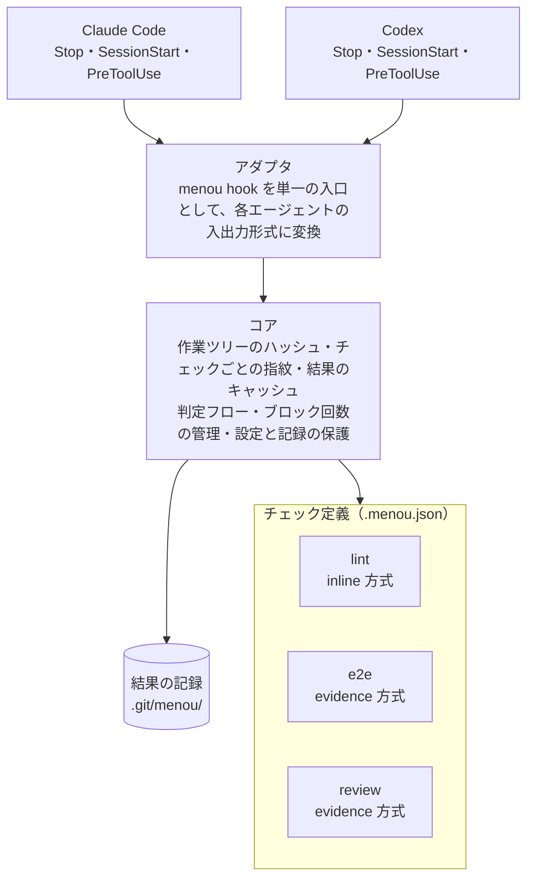

# アーキテクチャ

menou は 4 つの層で構成し、フックから呼ぶのは `menou hook <event>` という単一の入口だけにします。こうすると Claude Code と Codex で `hooks.json` を完全に共通化でき、差分はアダプタ層だけに閉じ込められます。



evidence 方式のチェックをエージェントが実行するときも `menou run <id>` でコアを通り、結果を記録するのは常にコアです。

## 各層の責務

| 層 | 責務 | 知らないこと |
| --- | --- | --- |
| アダプタ | フックの入力 JSON を読み、判定結果を各エージェントが受け付ける形式で出力する | チェックの中身、判定ロジック |
| コア | 状態のハッシュ計算、指紋とキャッシュ、判定、ブロック回数の管理、自己防衛 | 各チェックが何を検証しているか |
| プリセット | よく使うチェックの実行スクリプト（agent-review、e2e など） | 基盤の内部構造。普通のコマンドとして振る舞う |
| チェック定義 | プロジェクトごとの `.menou.json`。何をゲートするか | 実装の詳細 |

## チェックの 2 つの実行方式

| | inline | evidence |
| --- | --- | --- |
| 実行するのは | 完了時に基盤が実行 | エージェントが `menou run <id>` で実行 |
| 完了時の処理 | 実行して合否を判定 | 記録の合否と鮮度だけを確認 |
| 向いているもの | 速く決定的なもの（Lint、型チェック、フォーマット） | 遅い・高コスト・結果がぶれるもの（E2E、エージェントレビュー） |

どちらの方式でも、結果を記録するのは基盤です。

## 指紋とキャッシュ

指紋はチェックごとに次のように計算します。

```
指紋 = hash( チェック定義そのもの + paths に含まれるファイルの内容 )
```

- 一時インデックスに `git add -A` してから `git write-tree` で作業ツリー全体の tree を 1 回だけ作り、`git ls-tree -r <tree> -- <paths>` の出力をハッシュしてチェックごとの指紋を得る
- チェック定義を指紋に含めるので、コマンドやレビュー観点を変えると過去の結果は自動的に無効になる
- 同じ指紋で合格した記録があれば再実行しない。inline 方式でも、変更がなければ完了のたびに Lint が走ることはない
- 記録は `.git/menou/` に置く。`.git` の中なので指紋の計算に含まれず、コミットもされない

## Stop 時の判定フロー

1. 再帰呼び出し中（`MENOU_DISABLED=1`）、または `.menou.json` がないリポジトリなら通す
2. 作業ツリーの状態がセッション開始時（ベースライン）から変わっていなければ通す
3. `needs` の順序でチェックを評価する
   - `paths` の範囲がベースラインから変わっていない → 対象外
   - 今の指紋で合格した記録がある → OK
   - inline 方式 → その場で実行して記録する
   - evidence 方式 → 記録がない、不合格、古い、のいずれかなら不足として集める
   - 前提のチェックが通っていない → 実行も判定もしない
4. 不足があれば、足りないチェックと実行すべきコマンドをまとめて理由文にし、ブロックする
5. ブロック回数が `maxBlocks` を超えたら完了を許可し、人に確認を促すメッセージを出す

理由文は「`menou run e2e` を実行してください」「レビュー指摘は `.git/menou/out/review/findings.md` にあります」のように、次の行動が 1 つに決まる指示文にします。Codex では理由文が新しいユーザープロンプトとして扱われるためです。

## チェックとの約束事

| 終了コード | 意味 | 基盤の扱い |
| --- | --- | --- |
| 0 | 合格 | 指紋とともに合格として記録する |
| 1 | 不合格 | 不合格として記録し、ブロックする |
| それ以外 | チェック自体のエラー | 不合格と区別して記録し、続く場合は人に知らせる |

詳細を残したいチェックは、基盤が環境変数 `MENOU_OUT` で渡すディレクトリにファイルを書きます。基盤はその場所を理由文で案内するだけで、中身は解釈しません。

## セッションのライフサイクル

| フック | コアの処理 |
| --- | --- |
| SessionStart | ベースラインを記録する（再開やコンパクションでは上書きしない）。チェック一覧と実行コマンドの短い案内を出力する |
| PreToolUse | 結果の保存場所、`.menou.json`、`.claude/`、`.codex/` への編集を拒否する |
| Stop | 上記の判定フローを実行する |

## 自己防衛

- ゲートの設定や記録への編集を `PreToolUse` で拒否する。ただし Bash 経由の書き込みまでは防げないので、「うっかり」を防ぐ層と位置づける
- チェック定義を指紋に含め、設定の変更で過去の結果を無効にする
- ブロック回数の上限と、上限に達したときの人への通知

## エージェントレビューをチェックにする場合

レビューはプリセットとして提供し、基盤には特別な処理を足しません。

- **再帰の防止**：レビュアーとして `codex exec` や `claude -p` を起動するときは `MENOU_DISABLED=1` を渡す。渡さないと、レビュアーの Stop でもゲートが走り、レビューが無限に連鎖する
- **読み取り専用**：レビュアーがコードを変えると指紋が変わるので、読み取り専用のサンドボックスやツール制限をかけて起動する
- **交差レビュー**：実装したエージェントとは別のエージェントにレビューさせられるよう、`--reviewer` で切り替え可能にする
- **構造化された判定**：レビュアーには `{"verdict": "pass" | "fail", "findings": [...]}` の JSON で返させ、プリセットが終了コードに変換する
- **入力**：ベースラインからの差分と、観点を書いたファイル（`--rubric`）を渡す
